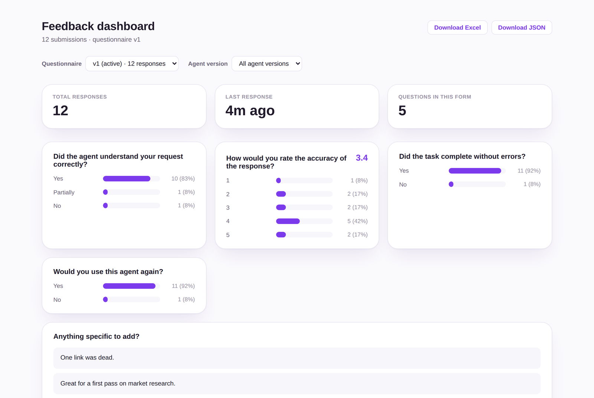
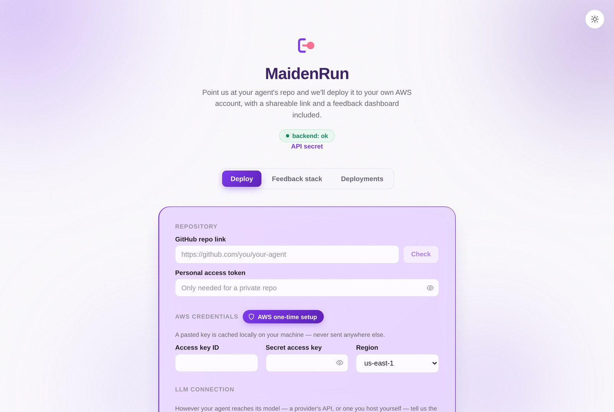
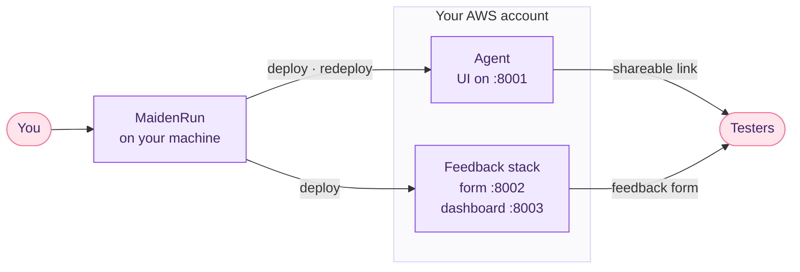

<div align="center">


# MaidenRun

**Get your AI agent in front of real testers, and find out what they think.**

Point MaidenRun at your agent's GitHub repo. It deploys the agent to your own AWS account,<br/>
gives you a link to share, and collects ratings and comments on a live feedback dashboard.

[](https://github.com/kaushik333/MaidenRun/actions/workflows/ci.yml)
[](LICENSE)


<br/>



</div>

## Why MaidenRun

Tracing tools like LangSmith and Langfuse show you what your agent *did*. MaidenRun tells you what people *thought of it*. That's the question that matters before launch, and it usually means hacking together hosting, a form, and a spreadsheet.

- **One link to share.** Your agent runs on a small EC2 instance at a fixed address, even when you redeploy.
- **Feedback built in.** A form for testers and a dashboard for you, with Excel and JSON export.
- **Compare versions.** Push a fix, click **Redeploy**, and see whether ratings went up for the new commit.
- **Your account, your data.** Everything runs in your AWS account. Secrets go to AWS Parameter Store, never into the instance's boot script.
- **Nothing left behind.** Teardown deletes every resource a deployment created, and a sweep finds anything left over in any region.

## Quickstart

You need [Docker](https://docs.docker.com/get-docker/) and an AWS account.

```bash
git clone https://github.com/kaushik333/MaidenRun.git
cd MaidenRun
cp .env.example .env
docker compose up --build
```

Open **http://localhost:5173**.

Then, once per AWS account, create a dedicated IAM user for MaidenRun. It takes about five minutes: follow [infra/README.md](infra/README.md), or click **AWS one-time setup** in the app.

## How to use it

1. **Deploy your agent.** Paste the repo link, click **Check**, add your LLM API key, and click **Deploy**. You get a link to the agent in a few minutes.
2. **Deploy a feedback stack.** On the **Feedback stack** tab, upload a questionnaire ([example](feedback-stack/feedback-questions.example.json)) and pick the agent it collects feedback for. Share the form link with testers. The dashboard link is yours.
3. **Iterate.** Push a change, then click **Redeploy** on the **Deployments** tab. The link stays the same, and the dashboard can filter and compare feedback by agent version.
4. **Tear down.** Click **Terminate**. A feedback stack's responses are exported first, and stay downloadable from the **Deployments** tab.

<p align="center"></p>

## Make your agent compatible

MaidenRun runs your repo with one command, so it needs:

- **One entry point at the repo root:** a `compose.yaml` / `docker-compose.yml`, or a single `Dockerfile`.
- **The agent's UI on port 8001.** Ports 8002 and 8003 are reserved for the feedback form and dashboard.

**Check** in the app tells you what's missing. To fix a repo automatically, give [adapt.md](backend/app/templates/adapt.md) to your coding agent.

## How it works



MaidenRun itself runs on your machine and uses boto3 to launch EC2 instances in your account. The agent instance clones your repo at the exact commit you checked and runs `docker compose up`.

## Cost

You pay AWS directly. A `t3.small` agent costs about **$0.026/hour** (≈ $19/month if left running), plus a little for its disk. A feedback stack costs the same. MaidenRun shows a running cost for every deployment, and tearing down stops all charges.

## Project structure

```
backend/          FastAPI control plane: validates repos, deploys to AWS, tracks cost
frontend/         React UI (the screenshots above)
feedback-stack/   The feedback form, dashboard and Postgres shipped to each feedback instance
infra/            The IAM policies for the one-time AWS setup
fixtures/         Sample repos the tests validate against
```

## Development

```bash
cd backend && uv sync --extra dev && uv run pytest              # control plane
cd feedback-stack/backend && uv sync --extra dev && uv run pytest  # needs Docker for Postgres
cd frontend && npm ci && npm run dev
uvx ruff@0.16.10 check backend feedback-stack/backend            # lint, same as CI
```

Issues and pull requests are welcome.

## License

[Apache 2.0](LICENSE)
